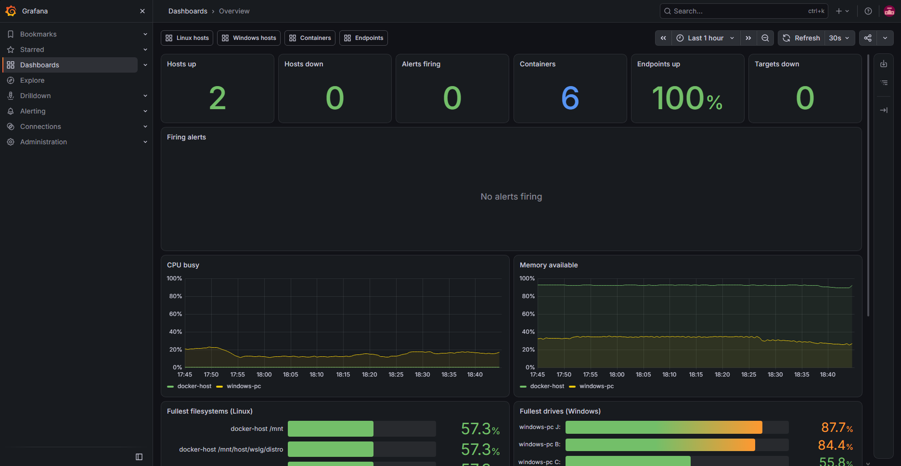
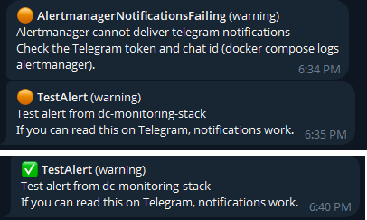
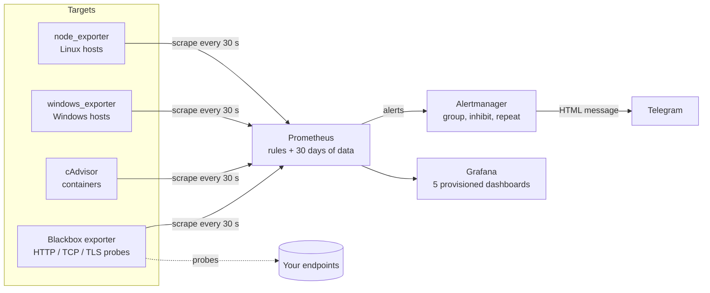

# Rack monitoring stack

**Prometheus, Alertmanager and Grafana in one `docker compose up`: Linux and Windows hosts,
Docker containers and web endpoints, with alerts that reach you on Telegram.**

A home lab or a small rack has the same problem as a data center: things fail quietly (a disk
fills up, a container restarts in a loop, a certificate expires) and you find out too late. This
stack watches the machines, the containers and the services, and sends a message only when a
person has something to do. It is built to run on a home Linux server and was developed and tested
on a Windows PC with Docker Desktop.



## What it does

| Area | How | Where you see it |
|---|---|---|
| Linux hosts | node_exporter: CPU, memory, swap, load, disks, inodes, network, temperatures, clock | Dashboard *Linux hosts* |
| Windows hosts | windows_exporter: CPU, memory, drives, network | Dashboard *Windows hosts* |
| Containers | cAdvisor: CPU, memory against limits, network, restarts | Dashboard *Containers* |
| Web endpoints and TCP services | Blackbox exporter: availability, latency, TLS certificate expiry | Dashboard *Endpoints* |
| Alerts | 34 alerts, each with a unit test ([list](docs/alerts.md)) | Telegram, dashboard *Overview* |
| The monitoring itself | A heartbeat alert, reload failures, undeliverable notifications | Telegram |

Alerts arrive on Telegram, written to be read at a glance:



## Quick start (Windows with Docker Desktop)

```powershell
git clone https://github.com/TexAlphaWolf/dc-monitoring-stack
cd dc-monitoring-stack
powershell -ExecutionPolicy Bypass -File tools\init-env.ps1   # random Grafana password + Telegram
docker compose up -d
```

Open <http://localhost:3000> (user `admin`, password from `.env`). To also monitor the Windows
PC itself, run `tools\install-windows-exporter.ps1` in an elevated PowerShell
([details](docs/windows.md)). Send yourself a test alert:

```powershell
powershell -ExecutionPolicy Bypass -File tools\test-alert.ps1
```

On a Linux server use `tools/init-env.sh` and
`docker compose -f docker-compose.yml -f docker-compose.server.yml up -d`.

## Architecture



More in [docs/architecture.md](docs/architecture.md).

## Design decisions

- **Few alerts that matter.** Every alert states what to do, has a `for:` delay against flapping,
  and an inhibition rule keeps a down host from also reporting its CPU, disk and memory.
- **Disk alerts that predict.** Besides "less than 15% free" there is a `predict_linear` alert
  for a disk that will be full within 24 hours, which is the one that actually saves you.
- **The alerting is monitored.** A `Watchdog` alert always fires and is routed to nobody;
  `AlertmanagerNotificationsFailing` tells you when Telegram stops working.
- **Everything is tested, including the alert path.** `promtool` unit tests cover every alert
  (firing and not firing cases), routing is asserted with `amtool`, every dashboard query is run
  against a real Prometheus, and CI starts the whole stack and checks that an alert travels
  Prometheus → Alertmanager → receiver.
- **Targets are data, not code.** Add a machine by editing `prometheus/targets/*.yml`; no restart.
- **Secrets stay out of files.** The Telegram token and chat id are Docker secrets fed from
  `.env`; Alertmanager reads them from files.
- **Dashboards are generated.** `tools/build_dashboards.py` writes the JSON and a test fails if
  the files drift from the generator.

## Testing

```powershell
powershell -ExecutionPolicy Bypass -File tools\check.ps1     # needs Docker and Python
```

runs `promtool check`, all alert unit tests, `amtool check-config`, routing assertions and the
repository consistency tests, with no stack running. CI additionally brings the stack up
(`docker-compose.ci.yml` swaps Telegram for a local webhook) and runs `tools/check_stack.py`
and `tools/check_dashboards.py`.

## Limitations

- The Docker Desktop node-exporter sees the Linux VM that runs Docker, not Windows: that is why
  the Windows PC has its own exporter.
- cAdvisor needs access to the Docker data directory and `/dev/kmsg`; on some Docker Desktop
  setups container names are missing, see [docs/operations.md](docs/operations.md).
- A single Prometheus and a single Alertmanager: no high availability, which is a deliberate
  choice for one rack. Back up the `prometheus-data` volume if the history matters.
- No logs and no traces (metrics only).

## More

[Alerts](docs/alerts.md) · [Windows PC](docs/windows.md) · [Operations](docs/operations.md) ·
[Architecture](docs/architecture.md) · [Security](SECURITY.md) · [Contributing](CONTRIBUTING.md)

## License

MIT - Luca Tessitore
